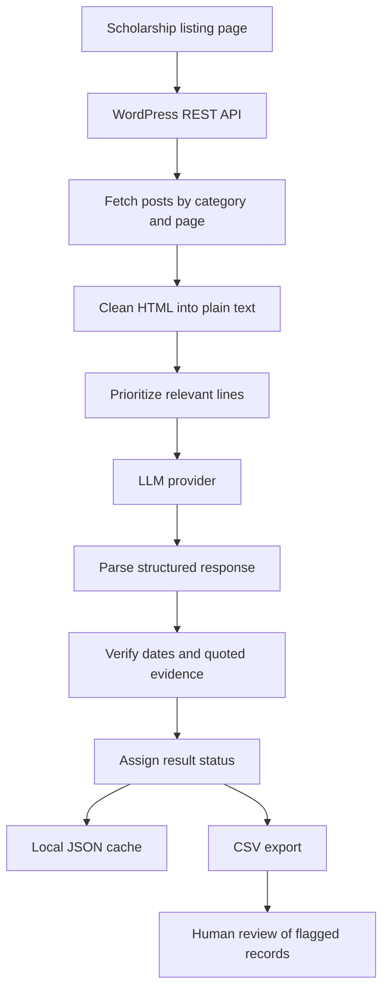

<div align="center">

# Scholarship Scraper

**An AI-assisted tool for extracting scholarship deadlines and international-student eligibility from Turkish scholarship announcements.**

[](https://www.python.org/)
[](https://developer.wordpress.org/rest-api/)
[](#configure-an-ai-provider)
[](#output)

[Features](#features) · [How It Works](#how-it-works) · [Installation](#installation) · [Usage](#usage) · [Architecture](#architecture) · [Output](#output)

</div>

---

## Overview

Searching scholarship announcements manually can be time-consuming, especially when application deadlines and eligibility rules are buried in long pages. **Scholarship Scraper** automates part of that research process by retrieving scholarship posts from the WordPress REST API used by [Guncel Eğitim](https://www.guncel-egitim.org/), then asking a configurable large language model (LLM) to identify the application deadline and whether international students may apply.

The tool checks the model's quoted evidence against the original announcement before assigning a result status. It exports the findings to a CSV file so they can be reviewed, filtered, and opened in spreadsheet software.

> **Important:** This project supports scholarship research; it does not submit applications or guarantee that a scholarship is currently open. Always check the original announcement before applying.

## Features

- **WordPress REST API retrieval** — fetches posts from the scholarship-application category without launching a browser.
- **AI-assisted extraction** — identifies the final application deadline and whether foreign/international students are eligible.
- **Evidence verification** — checks whether extracted dates and quoted evidence actually appear in the source text.
- **Multiple LLM providers** — supports local Ollama and cloud providers such as Gemini and Groq.
- **Provider fallback** — lets you list providers in priority order, for example a cloud provider followed by Ollama.
- **Local result cache** — stores model results to reduce repeated calls and unnecessary API usage.
- **CSV export** — records scholarship details, evidence, status, notes, and the model used.
- **Retry and error handling** — retries selected temporary website/API errors and records analysis failures.
- **Review-friendly statuses** — separates verified, incomplete, needs-checking, and failed records.
- **Partial-result saving** — attempts to save processed rows if execution is interrupted with `Ctrl+C`.

## Screenshots and Diagrams

Add the images listed below to the repository's `assets/` folder. The Markdown image links are prepared; GitHub will display each image after the corresponding file is added.

### Terminal Demo

Shows the command being run, per-scholarship progress, status messages, and the final CSV path.


### Pipeline

A high-level view of the data moving from the source website through extraction and verification to CSV output.


### Example CSV Output

A screenshot of a real CSV opened in a spreadsheet application. Use sample or anonymized scholarship data if needed.


### System Architecture

Shows the main runtime components and how they interact.


### Information Architecture

Shows how the repository's files and output artifacts are organized.


### Workflow

Shows the end-to-end process from selecting a page and provider to reviewing the exported records.


## How It Works

1. **Select a listing page.** The script requests a page of scholarship posts from the site's WordPress REST API.
2. **Resolve the category.** It looks up the `burs-basvurusu` category and uses it to filter the posts.
3. **Extract the page text.** HTML is converted to plain text, with scripts and other non-content elements removed.
4. **Prioritize relevant lines.** Long pages are shortened while prioritizing text related to nationality, deadlines, and application conditions.
5. **Ask the selected LLM.** The model returns structured data containing the deadline, deadline evidence, foreign-student eligibility, and eligibility evidence.
6. **Validate the evidence.** The script checks whether the extracted deadline and quoted evidence can be found in the source text.
7. **Cache and export.** Results are cached locally and written to a timestamped CSV file.
8. **Review flagged records.** Records that are incomplete, failed, or require checking should be reviewed against their source links.

## Architecture



The scraper uses an API-first approach rather than browser automation. The LLM is responsible for interpreting announcement text, while the Python code performs the source retrieval, text preparation, result normalization, evidence checks, caching, and CSV writing.

## Requirements

- Python 3.10 or newer is recommended.
- Internet access to retrieve scholarship announcements and use a cloud LLM provider.
- **One LLM option:**
  - [Ollama](https://ollama.com/) running locally with a compatible model, or
  - an API key for a supported cloud provider such as Gemini or Groq.

The project uses Python packages including `requests` and `beautifulsoup4`.

## Installation

### 1. Clone the repository

```bash
git clone https://github.com/Mohamed-2030-M/scholarship-scraper.git
cd scholarship-scraper
```

### 2. Create and activate a virtual environment

**Windows PowerShell**

```powershell
py -m venv .venv
.\.venv\Scripts\Activate.ps1
```

If PowerShell blocks activation for the current terminal session, run:

```powershell
Set-ExecutionPolicy -Scope Process -ExecutionPolicy RemoteSigned
.\.venv\Scripts\Activate.ps1
```

**macOS / Linux**

```bash
python3 -m venv .venv
source .venv/bin/activate
```

### 3. Install dependencies

```bash
python -m pip install --upgrade pip
python -m pip install -r requirements.txt
python -m pip install requests beautifulsoup4
```

The final command ensures the packages imported by the current `main.py` are installed.

## Configure an AI Provider

Choose **one** of the following configurations.

### Option A: Local Ollama

1. Install and start [Ollama](https://ollama.com/).
2. Download a model supported by your Ollama installation. For example:

   ```bash
   ollama pull qwen2.5:7b
   ```

3. Run the scraper:

   ```bash
   python main.py --page 1 --providers ollama:qwen2.5:7b
   ```

The default provider is Ollama. The model must be available locally, and the Ollama service must be running.

### Option B: Google Gemini

Set your API key in the current terminal session.

**Windows PowerShell**

```powershell
$env:GEMINI_API_KEY = "YOUR_GEMINI_API_KEY"
python main.py --page 1 --providers gemini
```

**macOS / Linux**

```bash
export GEMINI_API_KEY="YOUR_GEMINI_API_KEY"
python main.py --page 1 --providers gemini
```

### Option C: Groq

**Windows PowerShell**

```powershell
$env:GROQ_API_KEY = "YOUR_GROQ_API_KEY"
python main.py --page 1 --providers groq
```

**macOS / Linux**

```bash
export GROQ_API_KEY="YOUR_GROQ_API_KEY"
python main.py --page 1 --providers groq
```

Keep API keys private. Do not commit real keys, `.env` files containing secrets, or other credentials to GitHub.

### Provider fallback

You can specify providers in priority order. For example, try Gemini first and then use a local Ollama model if needed:

```powershell
$env:GEMINI_API_KEY = "YOUR_GEMINI_API_KEY"
python main.py --page 1 --providers gemini,ollama:qwen2.5:7b
```

Cloud provider model names and availability may change. Check the provider's current documentation when a model is unavailable.

## Usage

### Process a listing page

```bash
python main.py --page 1
```

When `--providers` is omitted, the script uses its default Ollama configuration.

### Process a small number of posts

Useful for a quick test before processing a full page:

```bash
python main.py --page 1 --limit 3
```

### Choose a provider and model explicitly

```bash
python main.py --page 1 --providers ollama:qwen2.5:7b
```

### Disable the saved cache for a run

```bash
python main.py --page 1 --no-cache
```

### List available model names for a provider

For a cloud provider, configure its API key first:

```powershell
python main.py --list-models gemini
```

The command-line options can also be inspected with:

```bash
python main.py --help
```

## Output

CSV files are written to the `output/` directory. File names follow this pattern:

```text
output/
├── scholarships_llm_page_1_DD_MM_YYYY.csv
└── llm_cache.json
```

The actual date in the CSV filename is generated when the run starts. If a file with the same name already exists, the script creates a different filename rather than overwriting the earlier file. If the CSV is open in Excel and cannot be written, the script attempts to save to an alternate filename.

### CSV fields

| Column | Description |
| --- | --- |
| `Operation Date` | Date and time when the run started |
| `Page` | Listing page number |
| `Scholarship Name` | Scholarship announcement title |
| `Link` | Original announcement URL |
| `Deadline` | Extracted final application deadline, or `Not specified` |
| `Foreigners Allowed` | `yes`, `no`, or `unknown` |
| `Evidence` | Source sentence supporting the eligibility result |
| `Deadline Evidence` | Source text supporting the extracted deadline |
| `Status` | Overall result status |
| `Notes` | Explanation of issues found during validation or processing |
| `Model` | Provider and model used, including cache indication where applicable |

### Status meanings

| Status | Meaning |
| --- | --- |
| `OK` | Required information was found and the quoted evidence passed the implemented checks |
| `Incomplete` | The deadline or eligibility could not be determined from the available text |
| `Check` | The extracted value or evidence did not pass a source-text check; manual review is needed |
| `Failed` | The page could not be analyzed successfully, for example because of an LLM or content error |

A status of `OK` is not a guarantee that the scholarship is still open or that every eligibility condition has been interpreted correctly. Verify important details on the original announcement.

## Repository Structure

```text
scholarship-scraper/
├── legacy/                 # Legacy project files
├── main.py                 # Main scholarship analysis script
├── check_words.py          # Text/keyword checking utility
├── list_headings.py        # Heading inspection utility
├── test_heading_filter.py  # Tests for heading filtering
├── requirements.txt        # Python dependencies
├── .gitignore
└── README.md
```

Runtime-generated files are stored in `output/`. They may not appear in a fresh clone until the scraper has been run.

## Troubleshooting

- **Ollama connection error:** Make sure Ollama is installed, running, and the configured model has been downloaded.
- **Cloud provider authentication error:** Check that the correct environment variable is set in the same terminal session where you run Python.
- **No posts found:** Confirm that the selected page exists and that the source website's WordPress API is available.
- **`Incomplete` or `Check` status:** Open the original scholarship link and verify the deadline and eligibility manually.
- **Slow first local run:** A local model may need extra time to load. The script has a long LLM timeout for this reason.
- **CSV appears to be missing:** Look in the `output/` directory and read the final `Saved to:` path printed by the script.
- **Dependency import error:** Activate the intended virtual environment and reinstall the dependencies.

## Testing

Run the project's heading-filter tests with:

```bash
python -m pytest -q
```

If `pytest` is not installed in the active environment:

```bash
python -m pip install pytest
python -m pytest -q
```

## Responsible Use

- Use the original announcement as the authoritative source for deadlines and eligibility.
- Respect the source website's terms and access policies.
- Avoid publishing API keys, private information, or unreviewed personal data.
- Treat LLM output as assistance for research, not as a final eligibility decision.

## Roadmap Ideas

Potential future improvements include configurable output paths, additional scholarship sources, richer filtering, scheduled runs, and workflow automation integrations.

## Contributing

Issues and pull requests are welcome. When reporting a problem, include the command used, a short description of the expected and actual behavior, and a sanitized error message. Never include API keys or other secrets.

## License

No license is specified in this repository at the time this README was prepared. Unless a license is added, reuse and redistribution may be subject to copyright restrictions.

---

<div align="center">

Built to make scholarship research more organized and evidence-aware.

**Repository:** [Mohamed-2030-M/scholarship-scraper](https://github.com/Mohamed-2030-M/scholarship-scraper)

</div>
